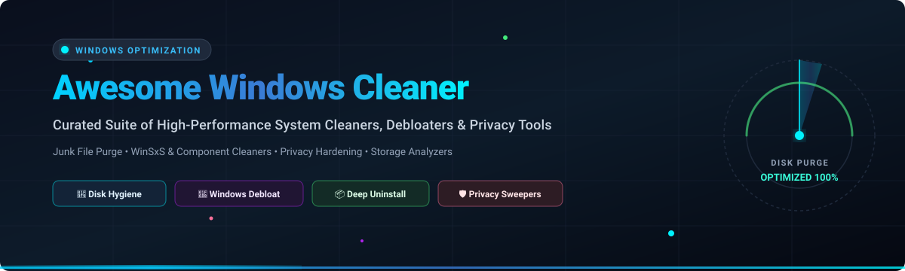

# 🚀 Awesome Windows Cleaner & System Optimization

  

  
  
  
  
  

---

## 📌 Comprehensive Overview & SEO Highlights

Welcome to the ultimate curated directory of **Windows Cleaner**, **PC Optimization**, **Disk Hygiene**, and **Windows 10/11 Debloating Tools**. Whether you are an IT administrator managing an enterprise fleet, a gamer tuning latency, a privacy advocate removing invasive telemetry, or a power user reclaiming gigabytes from bloated `WinSxS` stores, this ecosystem guide catalogs the leading **commercial SaaS solutions** and **battle-tested open-source GitHub repositories**.

### 🔍 Key Capabilities Covered:
- 🧹 **Junk & Cache Purging**: Purge temporary files, browser cache databases, error memory dumps, thumbnail stores, and obsolete update remnants.
- 🚀 **Windows 10 & 11 Debloating**: Remove pre-installed UWP bloatware packages, disable background diagnostic tracking, and streamline the Windows Shell.
- 📦 **Deep Application Uninstallation**: Completely eradicate stub installations, orphaned registries, and residual application clutter.
- 🗄️ **Storage & Disk Tree Analyzers**: Visualize interactive directory treemaps, locate multi-gigabyte files, and eliminate duplicate files with hash algorithms.
- 🛡️ **Privacy & Telemetry Hardening**: Block diagnostic telemetry beacons, disable consumer Cortana/Copilot background agents, and enhance endpoint security.

---

## 📑 Table of Contents
- [📊 Sector Overview & Market Dynamics](#-sector-overview--market-dynamics)
- [💼 Commercial & SaaS Platforms](#-commercial--saas-platforms)
- [🌟 Open-Source GitHub Projects](#-open-source-github-projects)
- [📈 Star History](#-star-history)
- [🤝 How to Contribute](#-how-to-contribute)
- [💖 Support](#-support)
- [📜 Disclaimer](#-disclaimer)

---

## 📊 Sector Overview & Market Dynamics

The global PC system cleaner, disk optimization, and endpoint management software sector represents an estimated market size of approximately **$1.8B to $2.4B annually**, driven by enterprise fleet maintenance, remote-work hardware longevity requirements, and consumer demand for responsive gaming and creator setups. 

The market dynamics exhibit a **moderately fragmented landscape** transitioning toward consolidation: established multi-billion dollar cybersecurity conglomerates (such as Gen Digital) maintain major market share with household consumer utilities, while an agile and rapidly growing ecosystem of independent developer utilities and open-source PowerShell/Rust projects dominates the enthusiast and power-user niches.

---

## 💼 Commercial & SaaS Platforms

The table below catalogs premier commercial and SaaS utilities for Windows PC cleanup and tune-up, sorted in descending order by parent company scale (valuation / market capitalization / revenue).

| Company Scale (Valuation / Revenue) 🏢 | Product Name 💻 | Core Capabilities 🛠️ | Pricing (Starting Tier) 💳 | Free Tier / Trial Limit 🎁 |
| :--- | :--- | :--- | :--- | :--- |
| **~$3.1B+ Market Cap / ~$3.8B Rev** *(Gen Digital Inc. / NASDAQ: GEN)* | **[CCleaner & CCleaner Cloud](https://ccleaner.com)** | Registry cleaning, temporary cache erasure, cloud-managed multi-endpoint hygiene | $29.95/year (CCleaner Professional 1 PC) | Free forever edition with manual junk cleaning & basic privacy protection (no auto-updates or cloud scheduling) |
| **~$3.1B+ Market Cap / ~$3.8B Rev** *(Gen Digital Inc. / NASDAQ: GEN)* | **[Avast Cleanup](https://avast.com)** | Automated registry sweeps, bloatware uninstallation, background app hibernation | $29.99/year (1 PC for first year) | 30-day free trial (Full Pro feature access for 30 days, no credit card required upfront) |
| **~$3.1B+ Market Cap / ~$3.8B Rev** *(Gen Digital Inc. / NASDAQ: GEN)* | **[AVG TuneUp](https://avg.com)** | Sleep Mode background resource limiter, broken shortcut scanner, browser cache purge | $29.99/year (1 PC for first year) | 30-day free trial with full disk cleaning and startup tuning capabilities |
| **~$50M - $100M Est. Valuation / ~$30M+ Rev** *(IObit Software)* | **[IObit Advanced SystemCare](https://iobit.com)** | AI-driven system health check, startup acceleration, browser anti-tracking | $19.99/year (1 PC, 1-year subscription) | Free forever edition with basic system cleaning and spyware protection (excludes deep registry and AI tuning) |
| **~$20M - $50M Est. Valuation** *(iolo technologies / RealDefense)* | **[System Mechanic](https://iolo.com)** | Real-time RAM decluttering, drive defragmentation, automated PC health sweeps | $39.95/year (System Mechanic Standard) | Free trial edition available for 30 days with automated repair diagnostics |
| **~$15M - $30M Est. Valuation** *(Ashampoo GmbH & Co. KG)* | **[Ashampoo WinOptimizer](https://ashampoo.com)** | SSD optimization, privacy telemetry disabling, duplicate hunter, junk purger | $30.00 one-time lifetime license (WinOptimizer 27) | Free forever edition (WinOptimizer Free with core junk cleaning and trace erasure) |
| **~$10M - $25M Est. Valuation** *(Glarysoft Ltd)* | **[Glary Utilities](https://glarysoft.com)** | 1-Click system maintenance, context-menu manager, registry repair, disk analyzer | $39.95/year (Glary Utilities Pro 3 PCs) | Free forever edition for non-commercial personal use with core 1-click clean |
| **~$5M - $15M Est. Valuation** *(WiseCleaner / Lespeed Tech)* | **[Wise Disk Cleaner](https://wisecleaner.com)** | Advanced multi-browser cache deletion, WinSxS slimming, Windows update residue wipe | $19.95/year (1 PC license) | Free forever edition including full junk file cleaner, system slim-down, and disk defrag |
| **Privately Held / Niche Indie Commercial** *(Cheetah Mobile Legacy / PC Distribution)* | **[Clean Master for PC](https://cleanmasterofficial.com)** | Instant junk removal, driver booster integration, residual cache shredder | $29.90/year (Clean Master PC Pro) | Free basic version with standard junk scan and manual junk cleaning |

---

## 🌟 Open-Source GitHub Projects

Below is the verified ecosystem of open-source Windows cleaners, debloaters, disk usage analyzers, and privacy tools. Each entry includes an official GitHub Stars_Badge linking directly to the project's stargazers page, sorted in **descending order by Stars_Count**.

| Rank 🏆 | Project & Repository 💻 | GitHub_Stars ⭐ | Description 📝 |
| :---: | :--- | :---: | :--- |
| 1 | **[Microsoft PowerToys](https://github.com/microsoft/PowerToys)** |  | Microsoft's official system utilities suite featuring File Locksmith, Registry Preview, Awake, and bulk file management tools. |
| 2 | **[Chris Titus Tech WinUtil](https://github.com/ChrisTitusTech/winutil)** |  | Comprehensive Windows utility for automated debloating, temporary file purges, registry performance tweaks, and Winget packaging. |
| 3 | **[Win11Debloat](https://github.com/Raphire/Win11Debloat)** |  | Lightweight, customizable PowerShell script to remove pre-installed bloatware, disable telemetry, and declutter Windows 10/11. |
| 4 | **[Rclone](https://github.com/rclone/rclone)** |  | Powerful command-line storage utility featuring `dedupe` and `cleanup` operations for local disks and multi-cloud drives. |
| 5 | **[ShareX](https://github.com/ShareX/ShareX)** |  | Highly rated open-source desktop productivity suite equipped with image compression, hash checking, and file tools. |
| 6 | **[Czkawka](https://github.com/qarmin/czkawka)** |  | Blazingly fast multi-threaded system cleaner written in Rust to find duplicates, empty directories, large files, and broken links. |
| 7 | **[UniGetUI (WingetUI)](https://github.com/Devolutions/UniGetUI)** |  | Intuitive graphical frontend for Winget, Scoop, and Chocolatey for managing, updating, and cleanly uninstalling Windows applications. |
| 8 | **[Bulk Crap Uninstaller (BCU)](https://github.com/BCUninstaller/Bulk-Crap-Uninstaller)** |  | High-volume open-source uninstaller that cleans orphaned files, uninstalls protected Windows apps, and wipes leftovers. |
| 9 | **[AtlasOS](https://github.com/Atlas-OS/Atlas)** |  | Open-source Windows modification focused on minimizing latency, removing tracking, stripping bloatware, and maximizing frame rates. |
| 10 | **[Dism++](https://github.com/Chuyu-Team/Dism-Multi-language)** |  | Community-favorite GUI frontend for Microsoft DISM capable of deep WinSxS store cleanup, OS compression, and driver hygiene. |
| 11 | **[Windows10Debloater](https://github.com/Sycnex/Windows10Debloater)** |  | Iconic PowerShell script to debloat Windows installations, disable diagnostic telemetry, and remove default bloatware apps. |
| 12 | **[Optimizer](https://github.com/hellzerg/optimizer)** |  | Advanced multi-language configuration and cleaning utility to disable unneeded services, flush temp drives, and enhance privacy. |
| 13 | **[System Informer](https://github.com/winsiderss/systeminformer)** |  | Open-source system monitoring and memory diagnostic utility for managing heavy background services and hunting resource leaks. |
| 14 | **[NanaZip](https://github.com/M2Team/NanaZip)** |  | Modern 7-Zip fork built for Windows 11 with context-menu integration, high-compression archives, and file hygiene tools. |
| 15 | **[Dust](https://github.com/bootandy/dust)** |  | High-speed Rust-based disk analyzer providing terminal-based graphical breakdown of directory consumption. |
| 16 | **[Sophia Script for Windows](https://github.com/farag2/Sophia-Script-for-Windows)** |  | Powerful PowerShell module for fine-tuning Windows 10/11, scheduling disk cleanups, and decluttering modern installations. |
| 17 | **[CompactGUI](https://github.com/IridiumIO/CompactGUI)** |  | Graphical tool utilizing Windows native CompactOS compression algorithms to shrink games and programs without performance loss. |
| 18 | **[DupeGuru](https://github.com/arsenetar/dupeguru)** |  | Open-source duplicate file finder matching file contents, filenames, and audio/picture tags using fuzzy comparison. |
| 19 | **[BleachBit](https://github.com/bleachbit/bleachbit)** |  | Industry-standard open-source system cleaner and privacy eraser with full support for Winapp2.ini custom cleaning rules. |
| 20 | **[Gdu (Go Disk Usage)](https://github.com/dundee/gdu)** |  | Ultra-fast console disk usage analyzer written in Go, specifically optimized for SSD throughput and interactive deletion. |
| 21 | **[Privacy.sexy](https://github.com/undergroundwires/privacy.sexy)** |  | Security hardening and OS debloating generator creating transparent and reversible cleaning scripts for Windows. |
| 22 | **[Bloatynosy](https://github.com/builtbybel/Bloatynosy)** |  | Streamlined Windows 11 debloater and component cleaner designed to strip unwanted bloat and unnecessary background tasks. |
| 23 | **[ThisIsWin11](https://github.com/builtbybel/ThisIsWin11)** |  | The classic PowerToys companion for Windows 11 system customization, package uninstallation, and disk optimization. |
| 24 | **[Win10 Initial Setup Script](https://github.com/Disassembler0/Win10-Initial-Setup-Script)** |  | Modular PowerShell script for automating post-installation debloating, telemetry removal, and disk cleaning. |
| 25 | **[WinDirStat](https://github.com/windirstat/windirstat)** |  | Legendary disk usage statistics viewer and cleanup tool with color-coded treemaps to spot space hogs immediately. |
| 26 | **[fclones](https://github.com/pkolaczk/fclones)** |  | High-performance CLI duplicate file identifier written in Rust, capable of quickly handling millions of files. |
| 27 | **[rmlint](https://github.com/sahib/rmlint)** |  | Fast file system lint remover for tracking down duplicated files, zero-byte artifacts, and broken directory links. |
| 28 | **[Winapp2.ini](https://github.com/MoscaDotTo/Winapp2)** |  | Community-driven cleaning definitions file containing over 3,000+ app cleaning routines for BleachBit and CCleaner. |
| 29 | **[Cleanmgr+](https://github.com/builtbybel/CleanmgrPlus)** |  | Enhanced modern replacement for the built-in Microsoft Disk Cleanup (`cleanmgr.exe`) with support for third-party cache removal. |
| 30 | **[TidyOS](https://github.com/builtbybel/TidyOS)** |  | Minimalist open-source utility for purging unnecessary system temporary files and configuring baseline Windows settings. |

---

## 📈 Star History

---

## 🤝 How to Contribute

Contributions are wholeheartedly welcome! To add or update an entry:
1. 🍴 Fork this repository.
2. 🌿 Create a descriptive branch: `git checkout -b add-cleaner-entry`.
3. ✍️ Add factual information, clear descriptions, pricing/free-tier specifics, or official GitHub links.
4. 🚀 Open a Pull Request for review!

---

## 💖 Support

If you find this repository helpful for maintaining your Windows systems, please consider:
- ⭐ Starring this repository on GitHub to help others discover it!
- 🍴 Forking and sharing with fellow sysadmins, developers, and PC builders!
- ☕ Supporting continuous maintenance and curation via the **[GitHub Sponsors Dashboard](https://github.com/sponsors/ishandutta2007)**. Thank you for your support!

---

## 📜 Disclaimer

*The software listed in this curated repository is provided for informational and educational purposes. Always exercise caution and create a System Restore point or complete drive backup prior to running deep registry cleaners, component slimming scripts, or uninstallation tools.*
